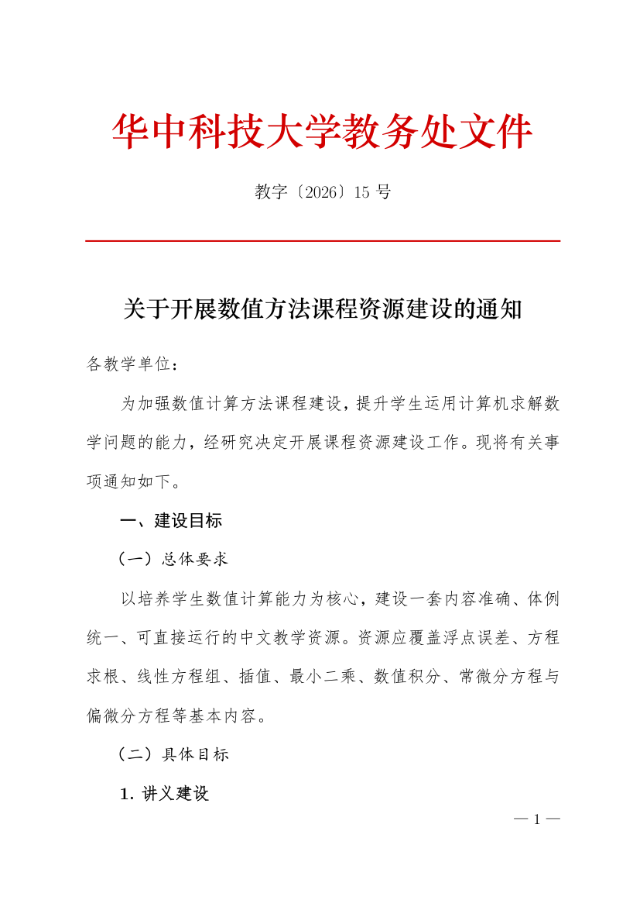

# gongwen-format



按 **GB/T 9704—2012《党政机关公文格式》** 排版中文公文与正式文档。

提供两条可落地路线：LaTeX 出 PDF、python-docx 出 DOCX，附带一个版面校验脚本——
量出实测尺寸并与国标逐项对照，不靠眼看。

> 版式参数不是凭记忆写的，全部在样例上实测过。校验结果见下文。

## 特性

- **一个 LaTeX 样式包**：`\usepackage{gongwen}` 即可获得 A4、版心 156×225 mm、
  三号仿宋、固定行距 28 磅、红色分隔线、奇偶页页码等全套版式
- **一个 python-docx 封装**：`GongwenDoc` 类，链式调用生成同样的版式
- **跨平台字体回退**：Windows / macOS / Linux 各有一套候选字体，缺字体时自动降级并提示
- **版面自动校验**：`verify_layout.py` 输出实测值与国标的对照表
- **踩坑记录**：16 条实测问题及处理办法

## 快速开始

### 1. 检查字体

```bash
python scripts/check_fonts.py
```

输出每个用途的字体状态。首选字体缺失时会给出回退建议。

### 2. 出 PDF

```bash
bash scripts/build_pdf.sh examples/notice.tex
python scripts/verify_layout.py examples/notice.pdf
```

`examples/notice.tex` 是最小可运行样例，改内容即可用：

```latex
\documentclass[UTF8, fontset=none, twoside]{ctexart}
\usepackage{gongwen}

\begin{document}
\gworg{××大学教务处文件}          % 红色发文机关标志
\gwdocno{教字〔2026〕15 号}        % 发文字号 + 红色分隔线
\gwtitle{关于开展××工作的通知}    % 二号标题
\gwto{各教学单位：}                % 主送机关（顶格）
\gwbody{正文段落……}
\gwhone{一、建设目标}              % 三级标题体系
\gwhtwo{（一）总体要求}
\gwhthree{1. 具体措施}
\gwattach{附件：1.\ 任务分工表}
\gwsign{××大学教务处}{2026年10月26日}
\end{document}
```

### 3. 出 DOCX

```bash
python scripts/gongwen_docx.py examples/notice.docx
python scripts/verify_layout.py examples/notice.docx
```

或当库用：

```python
from gongwen_docx import GongwenDoc

doc = GongwenDoc()
doc.org("××大学教务处文件")
doc.docno("教字〔2026〕15 号")
doc.title("关于开展××工作的通知")
doc.to("各教学单位：")
doc.body("正文段落……")
doc.h1("一、建设目标")
doc.h2("（一）总体要求")
doc.h3("1. 具体措施")
doc.attach(["1. 任务分工表", "2. 体例说明"])
doc.sign("××大学教务处", "2026年10月26日")
doc.save("notice.docx")
```

## 校验结果

本仓库样例的实测值（`verify_layout.py` 输出）：

```
项目            实测(mm)     国标(mm)  判定
页面宽            210.0      210.0   OK
页面高            297.0      297.0   OK
上白边（天头）      36.7       37.0   OK
下白边             33.9       35.0   OK
左白边（订口）      28.0       28.0   OK
右白边             26.0       26.0   OK
版心宽            156.0      156.0   OK
```

DOCX 版八项全部为精确值（`sectPr` 直接写入，不存在渲染误差）。

## 目录结构

```
gongwen-format/
├── SKILL.md                    技能说明与工作流（DSH skill）
├── README.md
├── LICENSE
├── assets/
│   └── gongwen.sty             可复用的 LaTeX 样式包
├── references/
│   ├── parameters.md           版式参数、字号对照、字体表
│   ├── elements.md             公文各要素的格式与顺序
│   └── pitfalls.md             16 条实测踩坑记录
├── scripts/
│   ├── build_pdf.sh            构建 PDF（xelatex 多遍）
│   ├── gongwen_docx.py         DOCX 生成库 + 样例
│   ├── verify_layout.py        版面校验
│   └── check_fonts.py          字体可用性检查
└── examples/
    ├── notice.tex              样例源码
    ├── notice.pdf              样例成品
    └── notice.docx             样例成品
```

## 关键版式参数

| 项目 | 数值 |
|---|---|
| 纸张 | A4，210 × 297 mm |
| 天头（上白边） | 37 mm ± 1 |
| 订口（左白边） | 28 mm ± 1 |
| 版心 | 156 × 225 mm |
| 每页 / 每行 | 22 行 / 28 字 |
| 行距 | 固定值 28 磅 |
| 正文 | 三号仿宋（16 pt） |
| 文件标题 | 二号小标宋（22 pt） |
| 一级 / 二级 / 三级标题 | 三号黑体 / 楷体 / 仿宋加粗 |
| 页码 | 四号宋体，单页居右、双页居左 |

## 依赖

- **PDF 路线**：TeX Live 2024（xelatex + ctex + fontspec）
- **DOCX 路线**：python-docx
- **校验**：PyMuPDF（仅校验 PDF 时需要）

```bash
pip install python-docx pymupdf
```

## 字体说明

- 正文仿宋、黑体、楷体、宋体在 Windows 上随系统提供
- **方正小标宋简体通常需要单独安装**，缺失时自动回退到华文中宋。
  两者字形接近但不相同，用于正式印发场合建议安装方正小标宋
- Linux 上通常没有仿宋，回退到 TeX Live 自带的 Fandol 系列；
  形制与国标有差异，需在交付说明中写明

`check_fonts.py` 会报告实际命中哪一套。

## 安装

### 作为 DSH 技能

```bash
git clone git@github.com:longaotiandedage/gongwen-format.git
cp -r gongwen-format ~/.dsh/skills/
```

重启 DSH 后，会话中提到"公文格式""红头文件""GB/T 9704"等即可自动加载该技能。

技能本身是纯文本（Markdown 说明 + 脚本 + LaTeX 样式包），不含可执行依赖；
具体排版时才需要下文的 TeX Live 等工具。

### 独立使用（不用 DSH）

把 `assets/gongwen.sty` 复制到你的 LaTeX 工程目录，然后：

```latex
\documentclass[UTF8, fontset=none, twoside]{ctexart}
\usepackage{gongwen}
```

`scripts/` 下的四个脚本也可单独调用：

| 脚本 | 作用 | 依赖 |
|---|---|---|
| `build_pdf.sh` | 构建 PDF（xelatex 多遍） | TeX Live |
| `gongwen_docx.py` | 生成 DOCX | python-docx |
| `verify_layout.py` | 校验版面 | PyMuPDF（PDF）/ python-docx（DOCX） |
| `check_fonts.py` | 检查本机字体 | 无 |

```bash
pip install python-docx pymupdf
```

### 依赖说明

| 用途 | 需要什么 | 不装会怎样 |
|---|---|---|
| 生成 PDF | TeX Live 2024 + 中文字体 | 无法出 PDF，其余功能不受影响 |
| 生成 DOCX | python-docx | 无法出 DOCX |
| 校验 PDF 版面 | PyMuPDF | 只能校 DOCX |
| 校验 DOCX 版面 | python-docx | 只能校 PDF |

### 卸载

```bash
rm -rf ~/.dsh/skills/gongwen-format
```

技能不写入任何全局路径，删除目录即完全移除。

## 参考

- GB/T 9704—2012《党政机关公文格式》
- GB/T 9704—1999（前版，现已废止）

## 许可

MIT，见 [LICENSE](LICENSE)。
